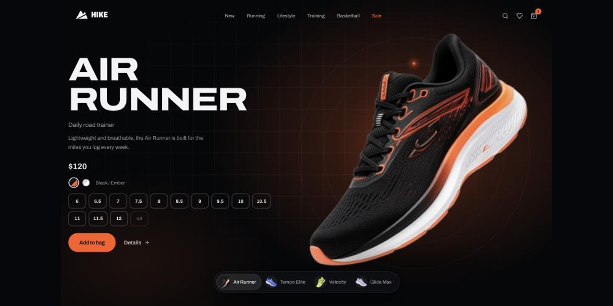
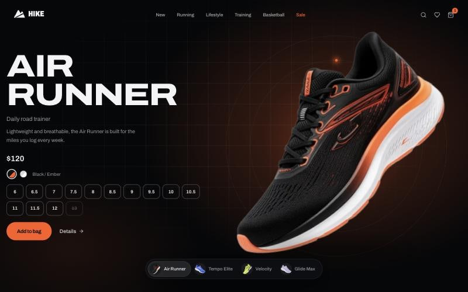
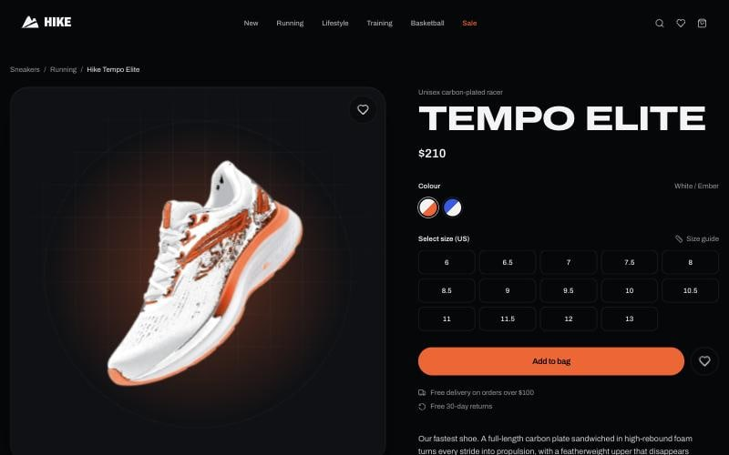
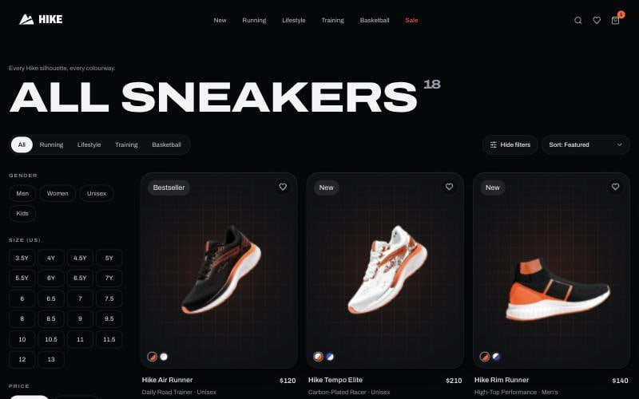
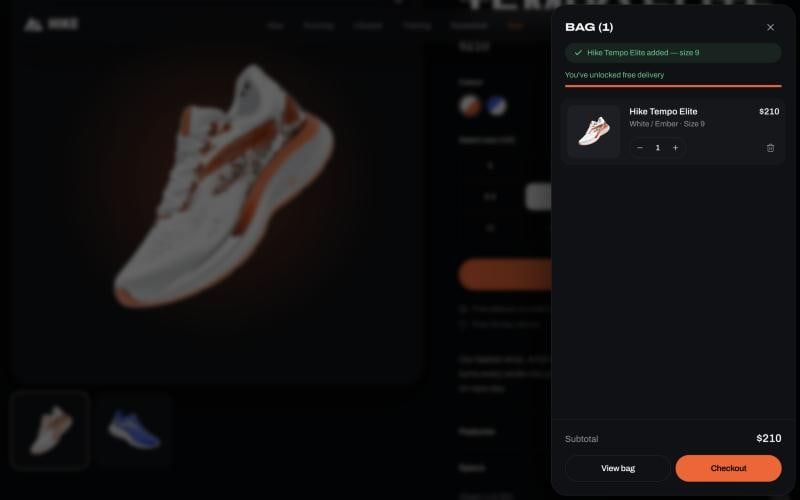
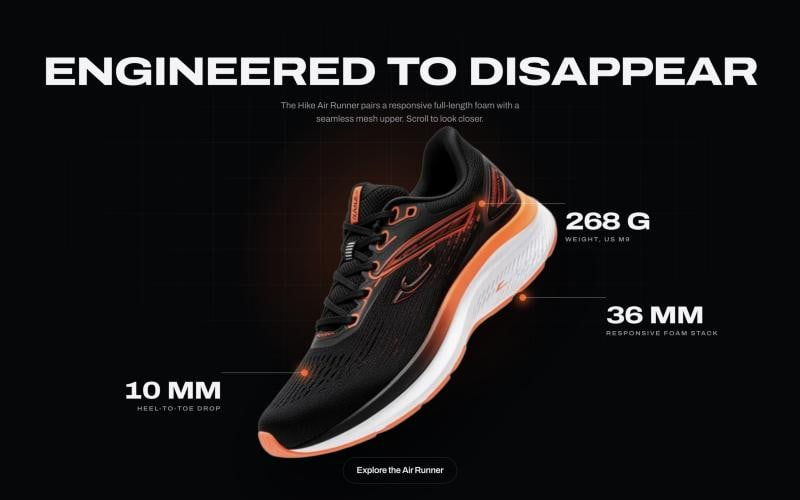
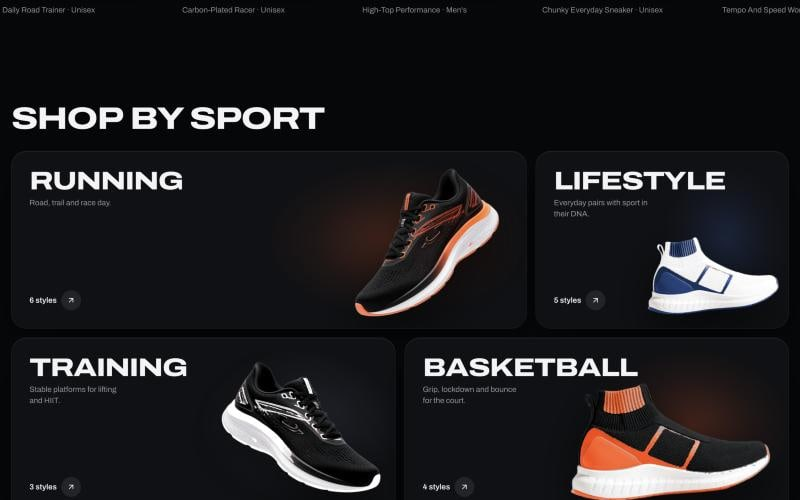
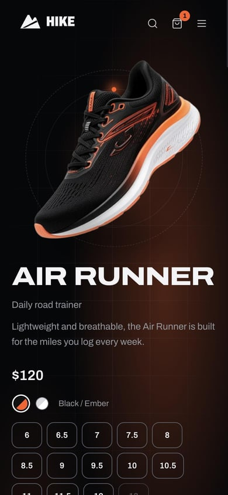
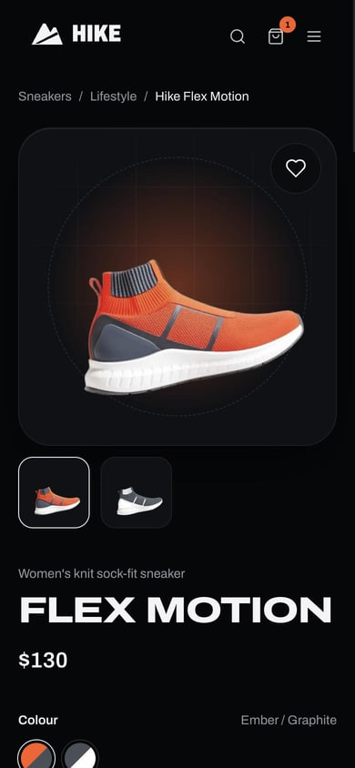
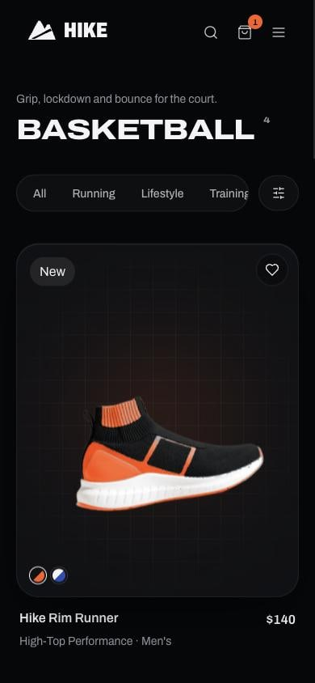

<div align="center">



# Hike — Sneaker Store

**A futuristic, motion-driven sneaker storefront built with React, TypeScript and Tailwind CSS.**
Full shopping flow, no backend, Google Analytics 4 on every step.

[](https://hike-sneaker-store.vercel.app)

[](https://github.com/SOHAIL-IQB/hike-sneaker-store/actions/workflows/ci.yml)


[](LICENSE)

</div>

---

## About

Hike started as an academic project on **digital analytics**: a demo store built to show how Google Analytics 4 tracks behaviour and conversions across a real shopping journey. Version 2 is a complete redesign. The store is now a night-lit "product lab": every shoe floats in its own light, and the page re-tints to the colourway you're looking at. Motion runs through the whole site, and it's still fully instrumented.

Everything runs in the browser. Products are static data; the bag, favourites and recently viewed are saved in `localStorage`; checkout is simulated and never asks for payment details.

## Screenshots

| Home | Product |
| :--: | :--: |
|  |  |
| **Catalogue** | **Bag drawer** |
|  |  |
| **Scroll-linked lab sequence** | **Shop by sport** |
|  |  |

<p align="center">
  
  
  
</p>

## Features

**Storefront**
- **Spatial hero.** The featured shoe floats in an orbit ring with pointer parallax, and a floating dock switches between shoes. You can pick a size and add to bag without leaving the hero.
- **Colourway light.** Every product, card and page takes its ambient glow from the colourway on show.
- **3D product cards.** Cards tilt toward the cursor, a glow follows the pointer in the shoe's own colour, and hovering a swatch switches the colourway.
- **Scroll-linked lab sequence.** The Air Runner turns as you scroll while its real specs draw in as callouts.
- Marquee ticker, trending and new-arrival rails, shop-by-sport bento, newsletter sign-up.

**Shopping**
- **Catalogue:** 18 shoes, 30 colourways, across Running, Lifestyle, Training and Basketball.
- **Listing:** category pills, filters for gender, size, price and sale, sorting and search. Every filter is kept in the URL, so you can share or bookmark a filtered view.
- **Product page:** lit product stage, colourway picker, size grid with sold-out sizes, size-guide panel, specs, related and recently viewed products.
- **Bag:** slide-out drawer plus a full bag page, with quantity and size changes and a free-delivery progress bar.
- **Checkout:** three steps (delivery → payment → review) with inline validation and an animated order confirmation.
- **Saved in the browser:** favourites, recently viewed and the bag persist in `localStorage` and stay in sync across tabs.
- **Search overlay:** press <kbd>⌘</kbd> <kbd>K</kbd> (<kbd>Ctrl</kbd> <kbd>K</kbd> on Windows and Linux) to open it.

**Quality**
- **Motion:** smooth scrolling with [Lenis](https://github.com/darkroomengineering/lenis) and spring animations with Framer Motion. Everything turns off for `prefers-reduced-motion`.
- **Accessibility (WCAG 2.2 AA target):** keyboard reachable throughout, visible focus rings, a skip link, dialogs built on Radix that trap focus and hand it back to the button that opened them, a title and announcement for every page change, labelled and validated form fields, and control borders that meet 3:1 contrast.
- **Performance:** route-level code splitting with idle prefetch, a self-hosted variable font, trimmed WebP product images, analytics loaded after the page, and long-lived caching for hashed assets.
- **Security:** security headers on every response (`X-Content-Type-Options`, `X-Frame-Options`, `Referrer-Policy`, `Permissions-Policy`) and a Content-Security-Policy; saved cart data is validated against the catalogue before it is trusted; the demo checkout never asks for payment details.
- **SPA rewrites** on Vercel, so deep links survive a refresh.
- **Tests and CI:** 265 unit and component tests; lint, tests, a dependency audit and the production build run on every push and pull request, with least-privilege permissions and pinned actions.

## Analytics (GA4)

The GA4 tag (`G-RVBB8Q0CW5`) loads in [`index.html`](index.html). Events go through [`src/lib/analytics.ts`](src/lib/analytics.ts). Event names and parameters are the same as in version 1, so existing reports keep working.

| Event | When | Parameters |
| --- | --- | --- |
| `view_product` | A product page opens | `item_id`, `item_name`, `price` |
| `add_to_cart` | A pair is added from the hero or a product page | `item_id`, `item_name`, `price`, `size` |
| `begin_checkout` | Checkout is started from the bag drawer or bag page | `value`, `items[]` |
| `purchase` | The demo order is placed | `transaction_id`, `value`, `shipping`, `items[]` |

Version 2 adds a `currency: "USD"` parameter to `add_to_cart`, `begin_checkout` and `purchase` so GA4 can report revenue. Nothing was renamed or removed.

The GA4 tag is bootstrapped from [`public/ga-init.js`](public/ga-init.js) and only sends data from the production host. Localhost and preview deployments get a no-op `gtag`, so development never pollutes the real reports. In development, every event is also logged to the console.

## Tech stack

| | |
| --- | --- |
| Framework | React 18 + TypeScript, Vite 5 |
| Styling | Tailwind CSS 3 with CSS-variable design tokens |
| Motion | Framer Motion 11, Lenis |
| UI primitives | Radix UI (Dialog, Accordion), Lucide icons |
| Routing | React Router 6 |
| Font | Archivo variable (width axis 62–125), self-hosted |
| Testing | Vitest + Testing Library (265 tests) |
| Hosting | Vercel |

The design system (tokens, type scale, motion rules and components) is documented in **[DESIGN.md](DESIGN.md)**.

## Getting started

```bash
git clone https://github.com/SOHAIL-IQB/hike-sneaker-store.git
cd hike-sneaker-store
npm install
npm run dev
```

Open <http://localhost:8080>.

| Command | What it does |
| --- | --- |
| `npm run dev` | Start the dev server on port 8080 |
| `npm run build` | Production build to `dist/` |
| `npm run preview` | Serve the production build |
| `npm test` | Run unit tests (store reducer, catalogue queries) |
| `npm run lint` | Run ESLint |
| `npm run images:recolor` | Generate images for new colourways (see below) |

## Project structure

```
src/
├── components/
│   ├── brand/       Hike logo and mark
│   ├── common/      Button, Overlay (drawer/dialog), QtyStepper, OrderSummary
│   ├── home/        HeroShowcase, Marquee, SportTiles, LabStory, Membership
│   ├── layout/      Header, Footer, BagDrawer, MobileMenu, SearchOverlay, SmoothScroll
│   └── product/     ProductCard, ProductRail, Price, FavoriteButton
├── data/            Catalogue, filters/sort/search queries, image lookup
├── lib/             GA4 helper, motion presets, utils
├── pages/           Home, Products, ProductDetail, Cart, Checkout, Favorites, NotFound
└── store/           Shop state (bag, favourites, recent) and UI state
scripts/             Colourway image generator
```

## Product images

The two original renders (`air-runner--black-ember`, `flex-motion--ember`) are AI-generated, logo-free shoes. Every other colourway is made from them by [`scripts/recolor-colorways.ts`](scripts/recolor-colorways.ts). It recolours each part of the shoe separately: the upper takes the colourway's first swatch, the trims take the second, and the sole stays as it is. Add a colourway to [`src/data/products.ts`](src/data/products.ts) and run `npm run images:recolor` to create its image.

## Credits

- Hero adapted from **Spatial Product Showcase** by [daiwiikharihar](https://21st.dev/@daiwiikharihar/components/spatial-product-showcase) on 21st.dev.
- Product card tilt and glow adapted from **Product Card** by [ravikatiyar162](https://21st.dev/@ravikatiyar162/components/product-card) on 21st.dev.
- Typeface: [Archivo](https://fonts.google.com/specimen/Archivo) by Omnibus-Type (SIL Open Font License).

Hike is a fictional brand made for a portfolio project. Prices, stock and specs are illustrative, and no real orders are taken.

## License

[MIT](LICENSE) © Sohail Iqbal
